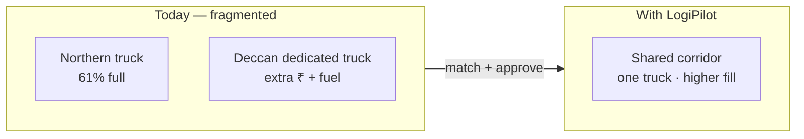
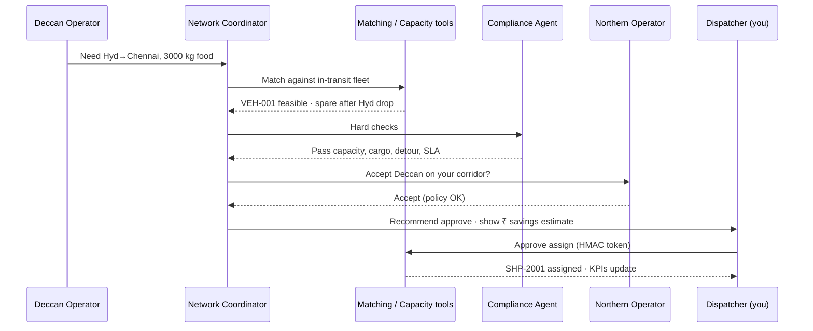
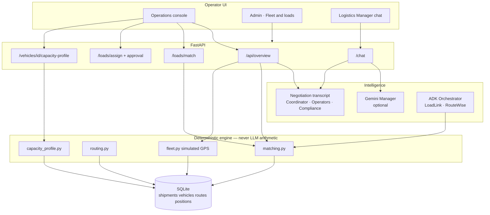
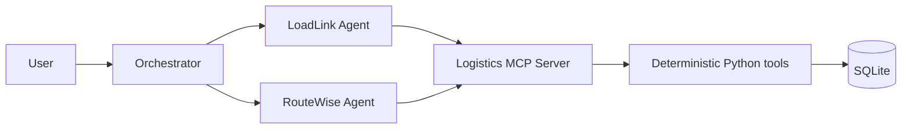
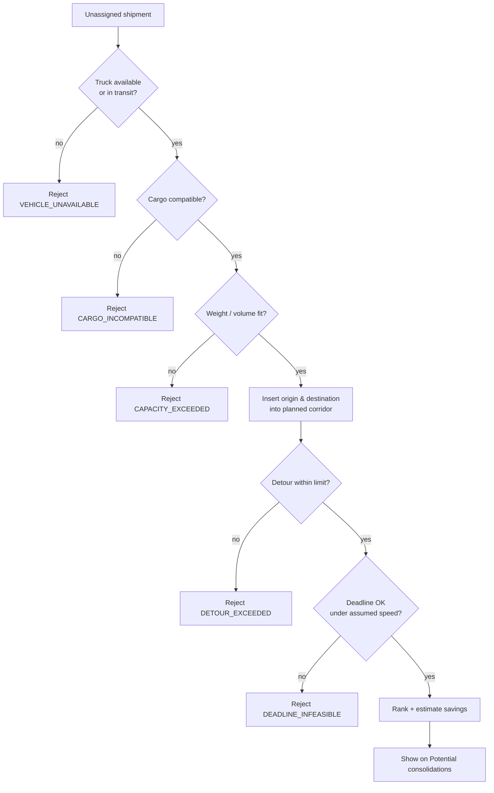
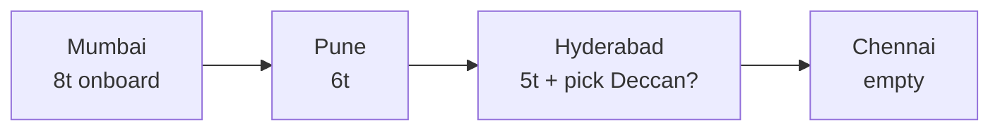
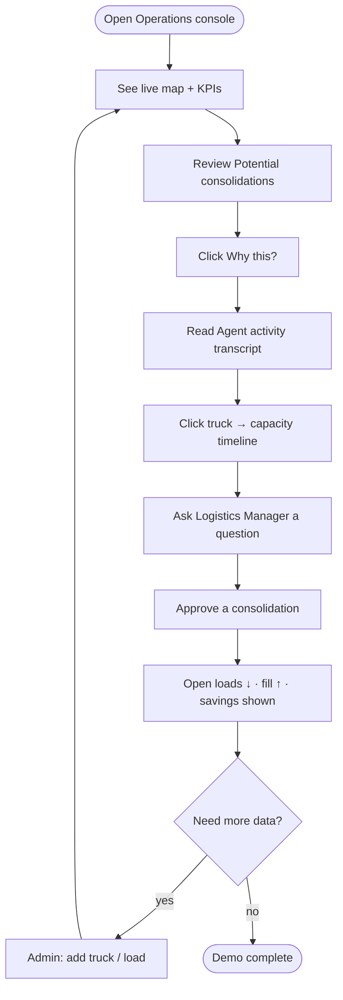
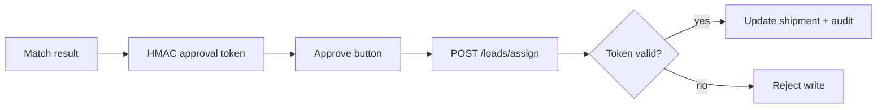

# FreightMesh · LogiPilot AI

### AI agents that turn empty truck space into shared, cheaper deliveries

LogiPilot is a **hackathon-ready multi-agent logistics console**. It finds when one company’s partially loaded truck can carry another company’s shipment on the same corridor — without inventing numbers, without silent overwrites, and with a human approval gate.

---

## Table of contents

1. [The problem](#the-problem)
2. [One-line pitch](#one-line-pitch)
3. [What you get](#what-you-get)
4. [Before vs after](#before-vs-after--the-story-in-one-picture)
5. [Architecture](#architecture-how-the-pieces-fit)
6. [Agents](#agents--what-exists-and-how-they-are-called)
7. [How consolidations work](#how-consolidations-are-calculated)
8. [Capacity after each stop](#capacity-after-each-stop)
9. [End-to-end operator journey](#end-to-end-operator-journey)
10. [Approval & write safety](#approval--write-safety)
11. [Seed world (demo data)](#seed-world-demo-data)
12. [KPI glossary](#kpi-glossary)
13. [Demo scenarios](#demo-scenarios-covered)
14. [5-minute judge walkthrough](#5-minute-judge-walkthrough)
15. [Quick start](#quick-start)
16. [API map](#api-map)
17. [Project layout](#project-layout)
18. [Configuration](#configuration)
19. [Security & principles](#security--product-principles)
20. [Roadmap](#roadmap-from-freightmesh-plan--whats-done-vs-next)
21. [Definition of done](#definition-of-done-hackathon-demo)

---

## The problem

Logistics teams often run trucks that are **only half full**, while other shippers pay for **separate trucks on the same highway**.

| Pain | What happens in the real world |
|------|--------------------------------|
| Wasted capacity | A Mumbai → Chennai truck leaves with 40–60% fill |
| Extra cost | Another company hires a dedicated Hyd → Chennai truck |
| Empty / underused miles | Return legs and mid-corridor gaps stay unused |
| Manual matching | Dispatchers cannot scan every corridor + SLA + cargo rule |
| Fragmented data | Company A does not see Company B’s open loads |
| Risky blind merges | Hazardous + food, missed deadlines, huge detours |

### Classic scenario (what we simulate)

```text
Northern Retail truck VEH-001
  Mumbai → Pune → Hyderabad → Chennai
  Capacity: 13,000 kg
  Onboard at Mumbai: 8,000 kg (61.5% full)
  Drops 2,000 kg at Pune and 1,000 kg at Hyderabad
  → spare capacity grows mid-route

Deccan Goods open load SHP-2001
  Hyderabad → Chennai · 3,000 kg · food · deadline soon

Without AI: Deccan books a second truck (VEH-002 style dedicated leg).
With LogiPilot: put Deccan on Northern’s truck after the Hyderabad drop —
               same delivery, lower cost, higher utilization.
```



---

## One-line pitch

> **We don’t just find trucks. We let AI coordinators and company operators negotiate how the network should share spare capacity — while deterministic tools do the math.**

---

## What you get

| Surface | Purpose | URL |
|---------|---------|-----|
| **Operations console** | Live map, consolidations, agent activity, copilot, approve | http://127.0.0.1:8080/ |
| **Admin** | Add trucks, add loads, reset demo, see fleet & open shipments | http://127.0.0.1:8080/admin |
| **ADK agents** | Gemini orchestrator + LoadLink + RouteWise | `uv run adk web app` |
| **SQLite simulation** | Resettable demo world (no JSON files at runtime) | `./data/logipilot.db` |

---

## Before vs after — the story in one picture



---

## Architecture (how the pieces fit)



### Design rule (non‑negotiable)

```text
Gemini / ADK          → understand, explain, delegate, negotiate
Python tools + SQLite → capacity, detour, cost, SLA, rankings
Human                 → approve consequential writes
```

---

## Agents — what exists and how they are called

### A) Google ADK agents (3) — real `LlmAgent`s

| Agent | Job | How to run |
|-------|-----|------------|
| `logistics_orchestrator` | Routes intent to specialists | `uv run adk web app` |
| `loadlink_agent` | Pooling / matching via MCP tools | sub-agent of orchestrator |
| `routewise_agent` | Baseline vs optimized routes via MCP | sub-agent of orchestrator |



### B) FreightMesh negotiation roles (scripted + tool-backed)

Shown in **Agent activity** on the Operations console. Generated by `run_negotiation()` whenever overview / chat / what-if runs:

| Role | Speaks for |
|------|------------|
| Logistics Manager | User intent framing |
| Network Coordinator | Asks for capacity, drives the process |
| Northern Retail / Deccan / CoastalMart Operators | Company policies & accept/reject |
| Compliance Agent | Hard fails: capacity, cargo, detour, deadline |
| Optimization Engine | Ranking & savings from tools |

> These are **not** separate ADK processes — they are a **transparent transcript** over the same matching engine, so demos are reliable and explainable.

### C) Dashboard copilot

`POST /chat` → Gemini (if `GOOGLE_API_KEY` + working model) grounded on tool context, else deterministic keyword Manager.

```bash
GOOGLE_API_KEY=your_key
LOGIPILOT_GEMINI_MODEL=gemini-flash-latest
```

| UX detail | Behavior |
|-----------|----------|
| Empty Ask | Does **nothing** — toast: type a question first |
| Answers | Markdown-rendered (`marked.js`) — headings, lists, bold |
| Source label | Shows AI Logistics Manager / LoadLink / Negotiation / RouteWise |

---

## How consolidations are calculated



**Savings (estimate):**

```text
standalone_cost   = fixed_cost + (₹/km × direct origin→destination km)
incremental_cost  = ₹/km × extra km from inserting the load on the corridor
avoided_savings   = standalone_cost − incremental_cost
```

If the load is already on the corridor, incremental km can be **~0** — that means *no extra driving*, not “free shipping.” The UI and Manager explain it as **standalone truck cost avoided**.

---

## Capacity after each stop

Trucks are not a single static fill % for the whole trip. Assigned shipments create a **timeline**:

```text
VEH-001 example (seed)

Stop          Event                         Onboard    Spare      Fill
Mumbai        ↑ pick 3 Northern loads       8,000 kg   5,000 kg   61.5%
Pune          ↓ drop 2,000 kg (SHP-1002)    6,000 kg   7,000 kg   46.2%
Hyderabad     ↓ drop 1,000 kg (SHP-1003)    5,000 kg   8,000 kg   38.5%
              ← ideal place to pick Deccan 3,000 kg
Chennai       ↓ drop remaining              0 kg       13,000 kg  0%
```



**In the UI:** click a truck on the map → drawer shows **filled / onboard / spare per stop**.  
**Find loads for this truck** = “which open shipments fit *this* vehicle’s spare capacity?”  
**API:** `GET /vehicles/VEH-001/capacity-profile`

---

## End-to-end operator journey



---

## Approval & write safety



- Reads are free (overview, match preview, chat, capacity).
- Consequential writes (`assign`) require a short-lived **HMAC approval token**.
- Agents never get unrestricted SQL.

---

## Seed world (demo data)

Reset anytime: **Admin → Reset demo data** or `POST /admin/seed` / `uv run logipilot-seed`.

| Entity | Role in the story |
|--------|-------------------|
| **VEH-001** Northern Retail | Hero truck · Mumbai→Pune→Hyd→Chennai · 13t · in transit · 8t onboard |
| **VEH-002** | Counterfactual dedicated Hyd truck (what Deccan would hire alone) |
| **VEH-003** | Small Bengaluru truck (capacity / cargo edge cases) |
| **SHP-1001/1002/1003** | Northern assigned multi-stop loads (create the capacity timeline) |
| **SHP-2001** Deccan | Hero open load Hyd→Chennai 3t food |
| **SHP-2007** CoastalMart | Competing Hyd→Chennai open load |
| **SHP-2004** ChemHaul | Hazardous Kochi↔Mumbai — should **reject** on food trucks |
| Other SHP-200x | Detour / size / SLA edge cases for Compliance |

Simulated GPS: VEH-001 mid-corridor (labeled **simulated live** on the map).

---

## KPI glossary

| KPI | Meaning |
|-----|---------|
| **In transit** | Trucks with `availability = in_transit` (on the road) |
| **Open loads** | Shipments with `status = unassigned` |
| **Opportunities** | Feasible consolidations after hard checks |
| **Est. savings** | Sum of avoided second-truck costs (estimate) |
| **Avg fill** | Mean utilization across the fleet |

---

## Demo scenarios covered

### Scenario 1 — Mid-corridor pooling (hero)

1. Reset demo data (Admin or Operations).  
2. Open **VEH-001** — see Pune/Hyd drops freeing space.  
3. Potential consolidations include **Northern Retail + Deccan Goods**.  
4. **Why this?** → capacity, corridor, savings.  
5. **Approve** → open loads decrease; fleet fill rises.

**Expect:** Agent activity shows Coordinator → Compliance pass → Northern accept.

### Scenario 2 — Hard reject (do not blindly merge)

| Case | Expected code / outcome |
|------|-------------------------|
| ChemHaul hazardous on food truck | `CARGO_INCOMPATIBLE` |
| Huge detour (e.g. Kochi↔Mumbai vs corridor) | `DETOUR_EXCEEDED` |
| Deccan + Coastal when remaining kg too small | Capacity exceed in Compliance transcript |

### Scenario 3 — Add fleet & load (admin)

1. Go to **/admin**  
2. **Add truck** with stops Hyderabad → Chennai  
3. **Add open load** Hyd → Chennai  
4. Return to Operations — map + opportunities update from SQLite  

### Scenario 4 — What-if

- Priority **cost / carbon / utilization**  
- Allow delay hours  
- Agent activity recalculates; recommendation can change  

### Scenario 5 — Copilot

Ask:

> Find the cheapest way to deliver today's Chennai shipments.

Or:

> Why this plan?

| Check | Pass criteria |
|-------|---------------|
| Empty Ask click | Toast only — no invented question |
| With Gemini key | Readable Markdown, not raw dumps |
| Without key | Deterministic keyword Manager still useful |

### Scenario 6 — RouteWise

**Optimize corridor** compares baseline vs NN+2-opt distance/fuel (same fuel assumptions both sides).

### Scenario 7 — Per-truck “Find loads”

1. Click VEH-001 on the map.  
2. Capacity drawer shows stop timeline.  
3. **Find loads for this truck** ranks open shipments against *that* vehicle only — not the whole fleet.

---

## 5-minute judge walkthrough

| Minute | Say / do |
|--------|----------|
| 0:00 | “Half-empty trucks and separate shippers on the same highway.” |
| 0:30 | Open Operations — map, KPIs, open loads. |
| 1:00 | Click VEH-001 — spare capacity grows after Pune & Hyd. |
| 1:45 | Point at Potential consolidations — Northern + Deccan. |
| 2:15 | Why this? + Agent activity (roles negotiate; tools do math). |
| 3:00 | Approve — open loads ↓, savings estimate shown. |
| 3:45 | Ask copilot a Chennai cost question — Markdown answer. |
| 4:15 | Admin: mention add truck / reset demo. |
| 4:45 | Close: “Shared capacity, grounded tools, human approval.” |

---

## Quick start

Requires **Python 3.10–3.13** (3.12 recommended).

```bash
cd Logistics_Manager
uv python install 3.12
uv venv --python 3.12
source .venv/bin/activate
uv pip install -e ".[dev]"
cp .env.example .env
# set GOOGLE_API_KEY and LOGIPILOT_GEMINI_MODEL=gemini-flash-latest

uv run logipilot-seed
uv run logipilot-api
```

Open:

- Operations: http://127.0.0.1:8080/  
- Admin: http://127.0.0.1:8080/admin  

ADK multi-agent UI:

```bash
uv run adk web app
```

Tests:

```bash
uv run pytest -q
```

---

## API map

| Method | Path | Purpose |
|--------|------|---------|
| GET | `/api/overview` | KPIs, fleet, opportunities, agent activity |
| GET | `/api/fleet/live` | Simulated GPS |
| GET | `/vehicles` | List fleet |
| POST | `/vehicles` | **Add truck** |
| GET | `/vehicles/{id}/capacity-profile` | Per-stop fill / spare |
| GET | `/shipments` | List loads |
| POST | `/shipments` | **Add open load** |
| POST | `/loads/match` | LoadLink matching |
| POST | `/loads/assign` | Commit (approval token required) |
| POST | `/chat` | Logistics Manager |
| POST | `/api/negotiate` · `/api/what-if` | Negotiation / what-if |
| POST | `/routes/optimize` | RouteWise |
| POST | `/admin/seed` | Reset demo world |

---

## Project layout

```text
app/
  api.py                 FastAPI + static UI routes
  agent.py               ADK root_agent
  agents/                Orchestrator, LoadLink, RouteWise
  services/
    matching.py          Pooling engine
    routing.py           NN + 2-opt
    negotiation.py       Multi-agent transcript
    capacity_profile.py  Per-stop capacity
    fleet.py             Simulated live GPS
    chat_service.py      Gemini + deterministic Manager
    overview.py          Dashboard payload
  static/
    index.html           Operations console
    admin.html           Admin · fleet & loads
mcp_servers/             Logistics MCP for ADK
database/                schema.sql + seed.py
tests/                   unit + acceptance
```

---

## Configuration

See `.env.example`. Important knobs:

| Variable | Role |
|----------|------|
| `GOOGLE_API_KEY` | Gemini for dashboard Manager + ADK |
| `LOGIPILOT_GEMINI_MODEL` | Use `gemini-flash-latest` (older flash IDs may 404) |
| `LOGIPILOT_MAX_DETOUR_KM` / `_PCT` | Corridor insertion limits |
| `LOGIPILOT_ROAD_FACTOR` | Haversine × factor = road estimate |
| `LOGIPILOT_APPROVAL_SECRET` | HMAC for assign approvals |

---

## Security & product principles

- Reads free; **writes need approval** + audit log  
- No unrestricted SQL for agents  
- Uploaded-doc instruction injection is out of scope here (FreightFlow later)  
- Sample data is **synthetic** and resettable  
- Map GPS is labeled **simulated live** — honest for demos  

---

## Roadmap (from FreightMesh plan — what’s done vs next)

| Phase | Status |
|-------|--------|
| Simulation world + deterministic matching | ✅ |
| RouteWise baseline / optimized | ✅ |
| Ops + Admin UI, map, approve | ✅ |
| Negotiation transcript + Compliance rejects | ✅ |
| Capacity-after-each-stop | ✅ |
| Gemini Manager on `/chat` | ✅ |
| Empty-Ask guard + Markdown copilot | ✅ |
| Full ADK company Operator `LlmAgent`s | Partial (ADK has LoadLink/RouteWise/Orchestrator) |
| Google Maps Routes API / Pub/Sub / Firestore | Optional later |
| Backhaul return-leg marketplace | Optional later |

---

## Definition of done (hackathon demo)

You can walk a judge through:

1. Problem of underfilled trucks + separate shippers  
2. Live map + stop-level spare capacity on VEH-001  
3. Agent activity showing ask → check → reject/accept  
4. One approved consolidation with ₹ savings as an **estimate**  
5. What-if or new load from Admin  
6. Copilot explanation in readable language  

That is LogiPilot: **shared capacity, grounded tools, human approval.**

---

## License / note

Built as a **Google ADK + Gemini hackathon MVP**. Not a production TMS or live carrier marketplace.
